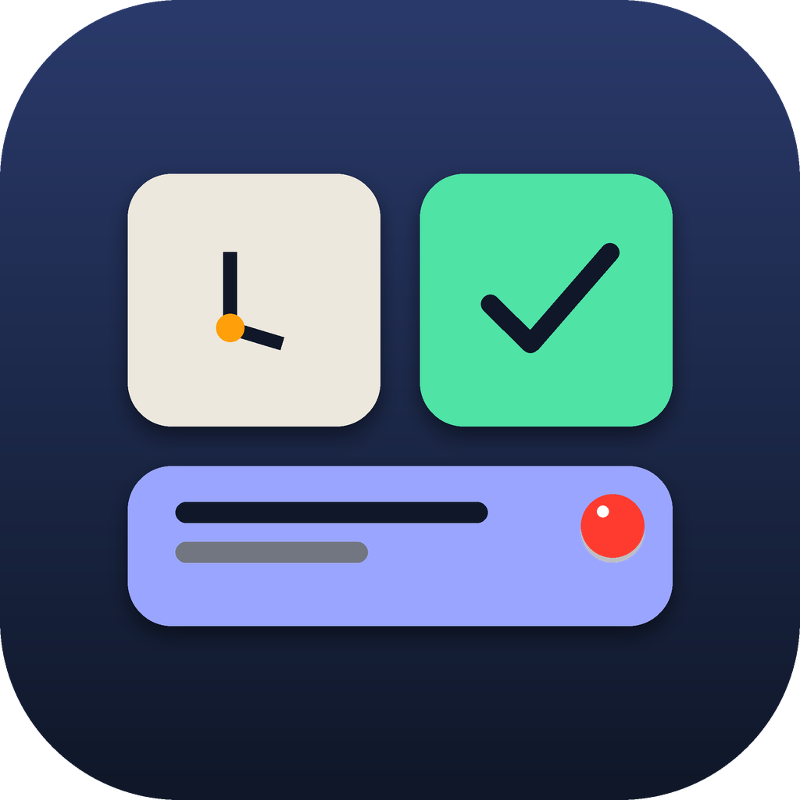

<p align="center">
  
</p>

<h1 align="center">Pinboard</h1>

<p align="center">
  A Windows app that pins macOS-style widgets to your desktop: pick them from a catalog, customize them and place them anywhere.
</p>

<p align="center">
  
  
  
  
  
</p>

Pinboard's widgets live on the desktop itself, not in the Windows widget board: they sit just above the desktop and below every other window, and stay visible with Show desktop (Win+D or the button at the end of the taskbar). The style follows macOS widgets: cards with very rounded corners, a semi-transparent background, thin type and a light or dark theme.

## Download

Get the latest installer or portable version from [Releases](https://github.com/tommipisca/Pinboard/releases/latest):

- `Pinboard-Setup-<version>.exe`: installs Pinboard for the current user (no admin rights needed) in `%LOCALAPPDATA%\Pinboard`, with shortcuts on the desktop and in the Start menu. Uninstall it from **Settings → Apps** in Windows.
- `Pinboard-portable-<version>.zip`: extract it anywhere and run `Pinboard.exe`.

.NET does not need to be installed. The installer is not code-signed: if Windows SmartScreen warns you on first launch, click **More info → Run anyway**.

## Features

**Dashboard**
- **Catalog**: every available widget with a live preview, filters by category and favorites (the star on each card) and search. It's the first page you see.
- **Details**: click a widget to see it larger, in each of its sizes, and add it to the desktop.
- **On your desktop**: the widgets you added, to customize, remove or move. The same widget can be added more than once, for example two clocks for different cities.
- **Settings**: start with Windows, move widgets, updates, quit.
- Closing the window keeps Pinboard running in the notification area; your widgets stay on the desktop.

**Customization**
- Before adding a widget (and later with **Customize**) you choose its size, theme (like Windows, light or dark), background color, accent color and transparency, plus the widget's own options. The preview updates as you change them.

**Widgets**

| Widget | Sizes | Own options |
| --- | --- | --- |
| Clock | small (analog), medium (analog + digital time, city and date) | your computer's time or another city's (about 90 cities plus every Windows time zone), second hand |
| Calendar | small (weekday, day, month), medium (also the whole month) | — |

**On the desktop**
- **Move widgets** (in the dashboard or the tray menu) makes the widgets draggable; they stay on the desktop below the other windows. **Lock position** locks them again.
- A new widget goes to the first free spot, starting from the top right.

## Updates

Pinboard checks GitHub for a new version 15 seconds after startup and then every 6 hours. When it finds one, it downloads it in the background (usually just the differences) and installs it when you quit Pinboard. You can also install it right away from **Settings → Updates → Restart and update**, or from the tray menu. This works for both the installed and the portable version. Automatic checks can be turned off in the same section. Your data in `%APPDATA%\Pinboard` is not touched.

## Development

Requirements: the [.NET 8 SDK](https://dotnet.microsoft.com/download/dotnet/8.0) on Windows.

```powershell
dotnet run --project src/Pinboard       # run the app (updates are disabled)
.\release.ps1                           # installer, portable zip and update packages in build\release\<version>
```

Command-line options:
- `--background`: start without opening the dashboard (used by start with Windows).
- `--floating`: regular always-on-top windows, for testing the design.
- `--debug`: write a log to `%APPDATA%\Pinboard\pinboard.log`.

Widgets, customizations, positions and favorites are saved in `%APPDATA%\Pinboard\settings.json`. Set the `PINBOARD_HOME` environment variable to use another folder, so you can test without touching your own widgets. The `widgets.json` file of older versions is converted automatically.

### Adding a widget

Each widget type is a class that extends `WidgetDefinition` in [`src/Pinboard/Widgets`](src/Pinboard/Widgets): name, description, category, sizes, default accent color, the view (`WidgetView`) and, if needed, the controls for its own options. Then add it to `WidgetCatalog.All`.

### Publishing a release

1. Bump `<Version>` in `src/Pinboard/Pinboard.csproj`, commit and push.
2. Create a GitHub release tagged `v<version>` (not a pre-release).
3. The [Release workflow](.github/workflows/release.yml) builds Pinboard with Velopack and attaches the installer, the portable zip, the `.nupkg` packages, `releases.win.json` and `RELEASES` to the release. It also downloads the previous release, so it can build a delta package.

The app reads the list of versions from the GitHub releases (`releases.win.json`), so every release must include it.

To build a release locally, install `vpk` with the same version as the Velopack package in `Pinboard.csproj` (`dotnet tool install -g vpk --version 1.2.161`) and run `.\release.ps1`. To test an update without publishing anything, build two versions with `.\release.ps1 -Feed <folder>` (the second with a higher `<Version>`), install the first one and run it with the environment variable `PINBOARD_UPDATE_URL=<folder>`.

The icon (`src/Pinboard/Assets/Pinboard.ico` and `assets/pinboard-icon-1024.png`) is generated by `python3 assets/make_icon.py`, which requires Pillow.

## Project structure

```
src/Pinboard/
├── Core/          # Settings, widget windows, desktop placement, tray icon, updates
├── Widgets/       # Widget catalog: definitions, styles, Clock and Calendar
├── Ui/            # Dashboard, customization window, styles and theme
├── Assets/        # App icon
├── App.xaml(.cs)  # Single instance, startup and exit
└── Program.cs     # Entry point: Velopack runs before WPF
assets/make_icon.py  # Generates the icon
release.ps1          # Builds a release with Velopack
```

> [!NOTE]
> Each widget is a top-level window kept just above the desktop and below every other window ([`DesktopHost.cs`](src/Pinboard/Core/DesktopHost.cs)). When Show desktop brings the desktop to the foreground, the widgets temporarily become "always on top" so they stay visible, and go back down when another window becomes active. Attaching them as children of the desktop (`SetParent` on `Progman`/`WorkerW`, the technique used by Lively) was tried, but on Windows 11 24H2 their content isn't drawn. Known limitation: widgets sit above the desktop icons and cover them where they overlap.

## Disclaimer

Pinboard is an independent personal project. It is not affiliated with, endorsed by or sponsored by Microsoft Corporation. Windows is a trademark of Microsoft Corporation.

## License

Distributed under the [MIT license](LICENSE).
